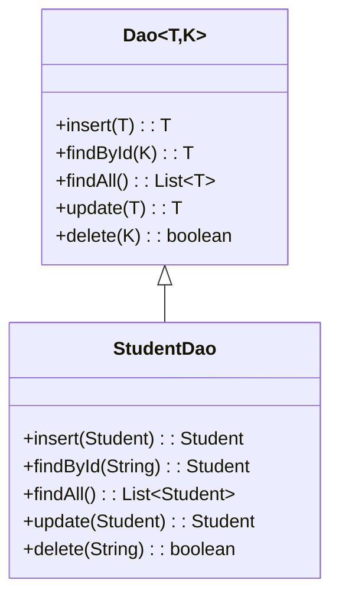

# Part A: Data-access pattern

## A3.1 Repeated steps vs varying parts
The common JDBC sequence is always:
1. open connection,
2. build SQL,
3. prepare/execute,
4. map ResultSet to Java objects,
5. close resources.

The variable parts are the table name, SQL query, and field-to-column mapping. These differences make a DAO abstraction useful.

## A3.2 Generic DAO pattern
A generic interface:
`Dao<T, K> { T insert(T obj); T findById(K id); List<T> findAll(); T update(T obj); boolean delete(K id); }`

### StudentDAO implementation outline
START
  INPUT student
  SQL = "INSERT INTO student (...) VALUES (...)"
  PREPARE statement
  EXECUTE
  RETURN student
END

### Mermaid class diagram

## A3.3 Student field mapping
| Java field | Database column | Key |
| --- | --- | --- |
| studentId | student_id | PK |
| name | name |  |
| branch | branch |  |
| year | year |  |
| cgpa | cgpa |  |

## Alternative: raw SQL in service code
When SQL is spread across service/UI layers, renaming a column requires updating many strings. With a DAO, the number of changes is concentrated in one class. Time and space cost are effectively the same, but maintainability and correctness improve dramatically.
